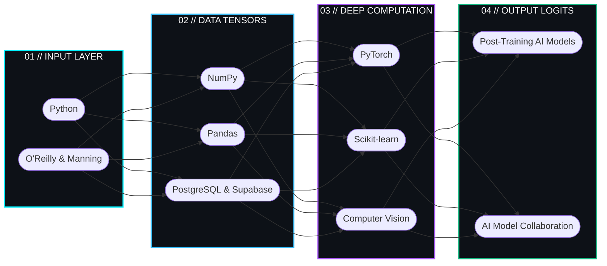

<div align="center">


<a href="[https://github.com/jofan-mk](https://github.com/jofan-mk)">
  
</a>

</div>

---

###  `[LAYER 00 :: INPUT_TENSOR]` — Identity & Vision Feature Map

<table>
<tr>
<td valign="top" width="38%">
<pre>
+--------------------------------+
| [CV_DETECTION :: CONF 0.998]   |
|                                |
|          .----------.          |
|        .'            '.        |
|       /   .--------.   \       |
|      |   /          \   |      |
|      |  |  (o)  (o)  |  |      |
|      |  |     __     |  |      |
|       \  \   \__/   /  /       |
|        '. '.______.' .'        |
|          '--.____.--'          |
|        _.-'        '-._        |
|      .'   [JOFAN-MK]   '.      |
|     /   AI ARCHITECTURE  \     |
|    |______________________|    |
|                                |
| TENSOR: [1, 3, 224, 224] FP16  |
+--------------------------------+
</pre>
</td>
<td valign="top" width="62%">

####  About My Work

I am a student deeply focused on **Artificial Intelligence architectures**. My current technical pursuit revolves around advanced **PyTorch** implementations, **computer vision**, and exploring **post-training pipelines** for open-source AI models.

Beyond writing code, I actively consume technical literature from **O'Reilly** and **Manning** to continuously refine both my theoretical knowledge and problem-solving methodologies.

<pre>
class JofanArchitecture(nn.Module):
    def __init__(self):
        super().__init__()
        self.backbone = "PyTorch + Computer Vision"
        self.pipeline = "Post-Training Open-Source AI"
        self.theory   = ["O'Reilly", "Manning"]

    def forward(self, raw_tensor):
        features = self.extract_vision(raw_tensor)
        aligned  = self.fine_tune(features)
        return self.deploy_supabase(aligned)
</pre>

</td>
</tr>
</table>

---

###  `[LAYER 01 :: FORWARD_PASS]` — Neural Architecture Pipeline



---

###  `[LAYER 02 :: WEIGHTS_&_PARAMETERS]` — Core Technologies

| Neural Layer | Category | Active Modules | Parameter Status |
| :--- | :--- | :--- | :--- |
| `L0 :: INPUT` | **Language** |  | `requires_grad=True` |
| `L1 :: CONV_ATTN` | **Frameworks** |   | `requires_grad=True` |
| `L2 :: TENSOR_OPS` | **Data Science** |   | `requires_grad=True` |
| `L3 :: MEMORY_BUS` | **Infrastructure** |   | `persistent=True` |

---

###  `[LAYER 03 :: BACKPROPAGATION]` — Current Focus & Collaboration

```text
+--------------------------------------------------------------------------+
| EPOCH [ACTIVE] :: OPTIMIZER = AdamW(lr=3e-4, weight_decay=0.01)          |
+--------------------------------------------------------------------------+
|                                                                          |
| [1] POST-TRAINING PIPELINES                                              |
|  |- Target   : Developing & fine-tuning post-training open-source models |
|  '- Progress : [##################..] 90% :: ACTIVE_FINE_TUNING          |
|                                                                          |
| [2] ADVANCED PYTORCH & COMPUTER VISION                                   |
|  |- Target   : Deepening knowledge in advanced PyTorch & Computer Vision |
|  '- Progress : [#################...] 85% :: CONTINUOUS_ITERATION        |
|                                                                          |
| [3] OPEN-SOURCE AI COLLABORATION                                         |
|  |- Target   : Collaborative projects (pre-trained & post-trained AI)    |
|  '- Status   : [####################] 100% :: READY_FOR_SYNC             |
|                                                                          |
+--------------------------------------------------------------------------+
```

---

###  `[LAYER 04 :: TELEMETRY]` — GitHub Analytics

<div align="center">
  
  
</div>

---

###  `[LAYER 05 :: OUTPUT_LOGITS]` — Connect With Me

| Node Endpoint | Handle / Address | Signal Badge |
| :--- | :--- | :--- |
| **LinkedIn** | Jofan Kalengkongan | []([https://www.linkedin.com/in/jofan-kalengkongan](https://www.linkedin.com/in/jofan-kalengkongan)) |
| **X (Twitter)** | `@brokecsstudent` | [](https://x.com/brokecsstudent) |
| **Email** | `jofankalengkongan01@gmail.com` | [](mailto:jofankalengkongan01@gmail.com) |
| **Portfolio** | *Web portfolio coming soon* |  |
